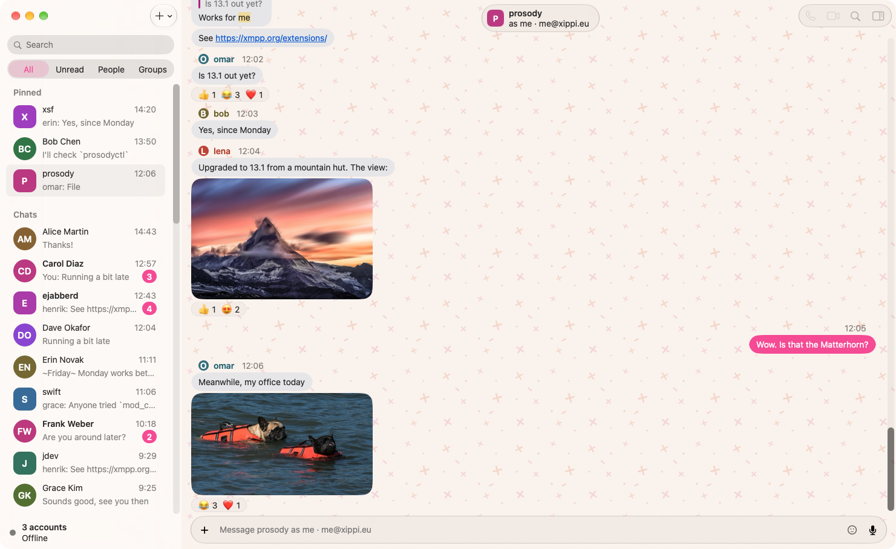

  <picture>
    <source media="(prefers-color-scheme: dark)" srcset="App/Assets.xcassets/XippiLogo.imageset/xippi-logo-dark.svg">
    
  </picture>

  

Xippi is an open-source, native macOS client for the XMPP/Jabber chat protocol.

## Licence

GPLv3 ([LICENSE](LICENSE)), with an additional permission for
distribution through app stores ([LICENSE.EXCEPTION](LICENSE.EXCEPTION)).
